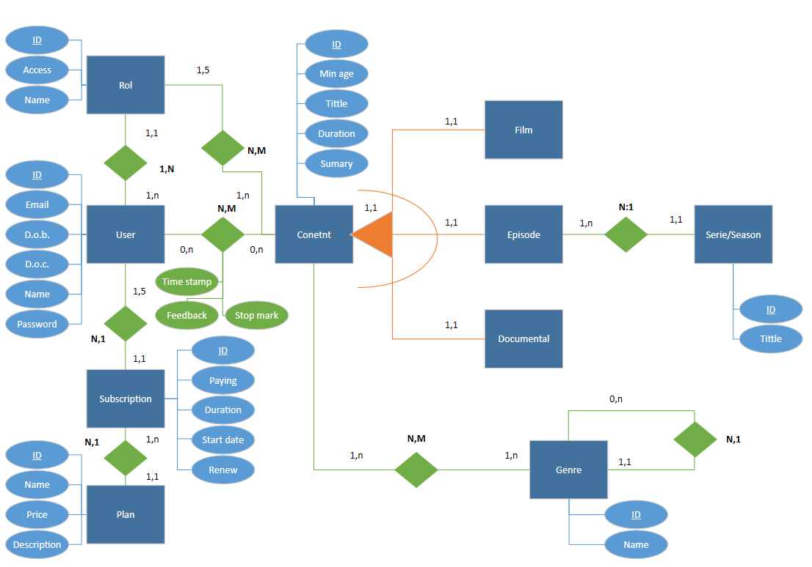

# Datu baseak - Proiektuaren Dokumentazioa

## 1. Brainstorming eta ideia orokorra

### 1.1. Brainstorming 
To begin with the database section, we opted to conduct a brainstorming session to generate as many ideas as possible for the project. Through this method, we managed to identify most of the entities and attributes that appear in the final database.
    
### 1.2. Ideia orokorra 
Once the brainstorming phase was completed, we set out to link all the gathered ideas in the most optimal way possible, while adapting them to our website vision. In this step, we designed an initial schema to make it as clear and easy to build as possible. Having done this will simplify the process when creating our E-R diagram

---

## 2. E/R esquema

### 2.1. Diseño definitivo E/R esquema
With the workload greatly simplified thanks to the previous step, our task was reduced to three simple steps. First, we streamlined the schema to adapt it to our actual needs. At this point, we discarded the entire production section and the 'Komentario' entity so that the final design would not become overly extended. Second, we drew the schema on paper, including all attributes, defining the cardinalities, and applying the precise notation for everything. The third and final step was to correct various errors found along the way to arrive at the definitive draft.

---

### 2.2. Digitalizar el E/R esquema
With a clear draft defined, we decided to create a digitalized version to further refine our work and correct other errors discovered along the way. For this task, we chose to use Microsoft Visio. The process simply involved transferring what was drawn in pencil on paper to the app using its various shapes and connectors. To make the design even clearer, we used different colors for each element (for example, green for relationships).

---

### 2.3. Explanation
**Data base explanation:**

We want to store different data for a company that provides a web platform similar to Netflix.

To fulfill this request, we begin with a user entity, through which we will collect the following data: Name, ID, Password, date of creation of the account, date of birth, and email address.

Also, each user will acquire a plan to access our platform. The plans can be one of these 4: Individual basic, individual premium, family basic, and family premium. To keep this data correctly, we decided to create two different entities, “subscription” and “plan”. By making this division, we can identify which users are on the same family plan. On the plan entity, we will keep this information: Name, ID, Price per month, and description (explaining if the plan has ads…). On the subscription entity, we will keep: ID, Payment method, Duration, start date, renewal type (Automatic or manual). A user must have one subscription, and each subscription will have between 1 and 5 users (family plans maximum capacity of users will be 5). Each subscription is linked to a plan, and a plan can have multiple subscriptions.

Additionally, each user will have a role, and a role can belong to multiple users. The web will only have 2 different roles, adults and kids. The role entity will keep the name, ID, and Access type (if it has complete access or access to under 18 content only). This entity is linked to a content entity. A role can allow multiple contents, and a content is allowed by 1 or 2 roles (because there are only 2 different roles); therefore, 18+ content will only be seen by adults, and children's content could be watched by kids and adults as well.

The content entity will keep this information: Title, ID, minimum age required to watch, duration, amount of likes, and amount of dislikes. Also, this entity is linked to “user”; a user can watch no content or watch multiple contents, and each individual content can be watched by no users or by multiple users. Also, in the relationship, we will keep the stop marker, the feedback and the timestamp (we will know at what exact point of the content the user stopped watching it the last time).

To continue, we want to store different types of content, so we implemented an ISA relation with complete exclusivity. So, we have 3 sub-entities: film, documentary, and episodes.  Episodes,  will be the only entity that will have anything different, because we want to know each episode from what season/serie is. To do this, we linked to another entity called season/serie, which will keep the ID, and the title. Each episode belongs to a serie/season and each serie/season will have multiple episodes.  

To conclude, we will keep the genre and subgenres of the content. To do this, we created another entity called genre; it will keep the ID and the name, and it will be connected to content. Each content can have multiple genres, and each genre applies to multiple contents. To store the subgenres, we created a recursive relationship. Each genre can have 0 or many subgenres, and each subgenre belongs to only one genre.

---
## 3. Relational model
### 3.1. Relational model
**Plan** : ( <u>IDplan</u>, name, price, description )

**Subscription** : ( <u>IDsubscription</u>, paying method, renew type, duration, date start, <mark>IDplan</mark> )

**Users** : ( <u>IDuser</u>, Name, password, date of birth, date of creation, email, <mark>IDsubscription</mark>, <mark>IDrol</mark> )

**Rol** : ( <u>IDrol</u>, Name, Access type )

**Content** : ( <u>IDcontent</u>, title, minimun age, duration, sumary )

**Film** : ( <u>IDcontent</u> )

**Documental** : ( <u>IDcontent</u> )

**Episodes** : ( <u>IDcontent</u>, <mark>IDseason</mark> )

**Serie / season** : ( <u>IDseason</u>, title )

**Content + rol** : ( <mark><u>IDrol</u></mark>, <mark><u>IDcontent</u></mark> )

**Content + users** : ( <mark><u>IDusers</u></mark>, <mark><u>IDcontent</u></mark>, <u>time stamp</u>, <u>stop mark</u>, <u>feedback</u> ) 

---

## 3. Normalization
### 3.1. Normalization
#### 3.1.1. Atomic values
**Is there any repeated information?** 
**Plan** : ( <u>IDplan</u>, name, price, description ) &rarr; It contains unique values.

**Subscription** : ( <u>IDsubscription</u>, paying method, renew type, duration, date start, <mark>IDplan</mark> )

**Users** : ( <u>IDuser</u>, Name, password, date of birth, date of creation, email, <mark>IDsubscription</mark>, <mark>IDrol</mark> )

**Rol** : ( <u>IDrol</u>, Name, Access type )

**Content** : ( <u>IDcontent</u>, title, minimun age, duration, sumary )

**Film** : ( <u>IDcontent</u> )

**Documental** : ( <u>IDcontent</u> )

**Episodes** : ( <u>IDcontent</u>, <mark>IDseason</mark> )

**Serie / season** : ( <u>IDseason</u>, title )

**Content + rol** : ( <mark><u>IDrol</u></mark>, <mark><u>IDcontent</u></mark> )

**Content + users** : ( <mark><u>IDusers</u></mark>, <mark><u>IDcontent</u></mark>, <u>time stamp</u>, <u>stop mark</u>, <u>feedback</u> ) 