# Datu baseak - Proiektuaren Dokumentazioa

## 1. Brainstorming and general idea

### 1.1. Brainstorming 
To begin with the database section, we opted to conduct a brainstorming session to generate as many ideas as possible for the project. Through this method, we managed to identify most of the entities and attributes that appear in the final database.
    
### 1.2. General idea 
Once the brainstorming phase was completed, we set out to link all the gathered ideas in the most optimal way possible, while adapting them to our website vision. In this step, we designed an initial schema to make it as clear and easy to build as possible. Having done this will simplify the process when creating our E-R diagram

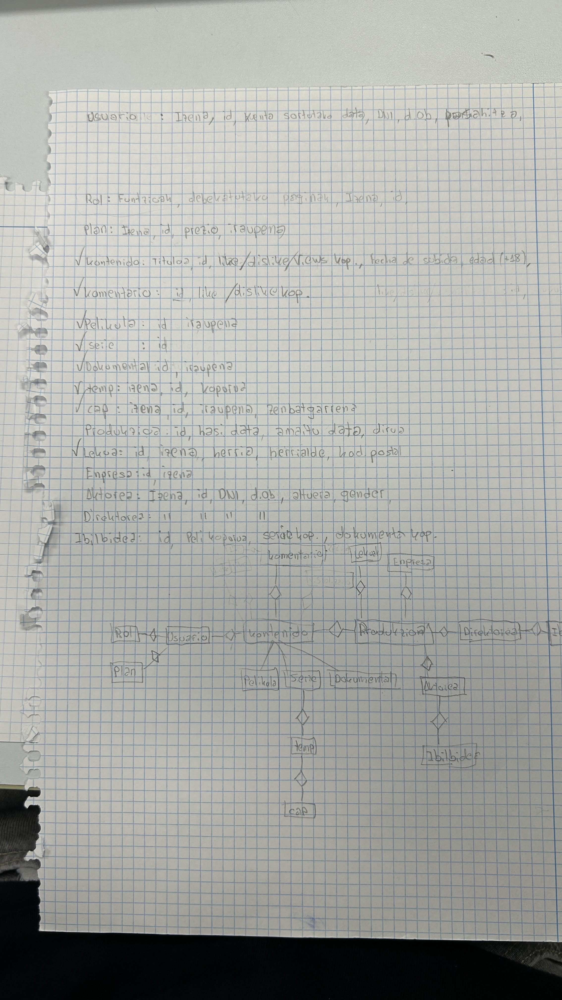

---

## 2. E/R diagram

### 2.1. Final Entity-Relationship (ER) diagram design
With the workload greatly simplified thanks to the previous step, our task was reduced to three simple steps. First, we streamlined the schema to adapt it to our actual needs. At this point, we discarded the entire production section and the 'Komentario' entity so that the final design would not become overly extended. Second, we drew the schema on paper, including all attributes, defining the cardinalities, and applying the precise notation for everything. The third and final step was to correct various errors found along the way to arrive at the definitive draft.

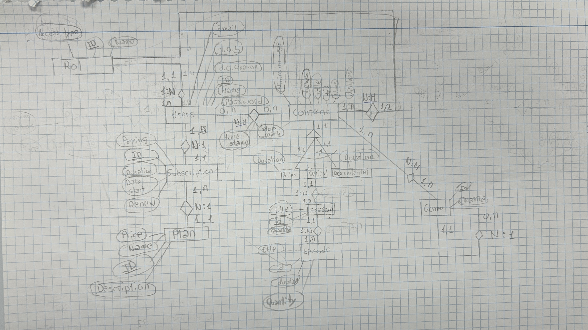

---

### 2.2. Digitize the E/R diagram   
With a clear draft defined, we decided to create a digitize version to further refine our work and correct other errors discovered along the way. For this task, we chose to use Microsoft Visio. The process simply involved transferring what was drawn in pencil on paper to the app using its various shapes and connectors. To make the design even clearer, we used different colors for each element (for example, green for relationships).

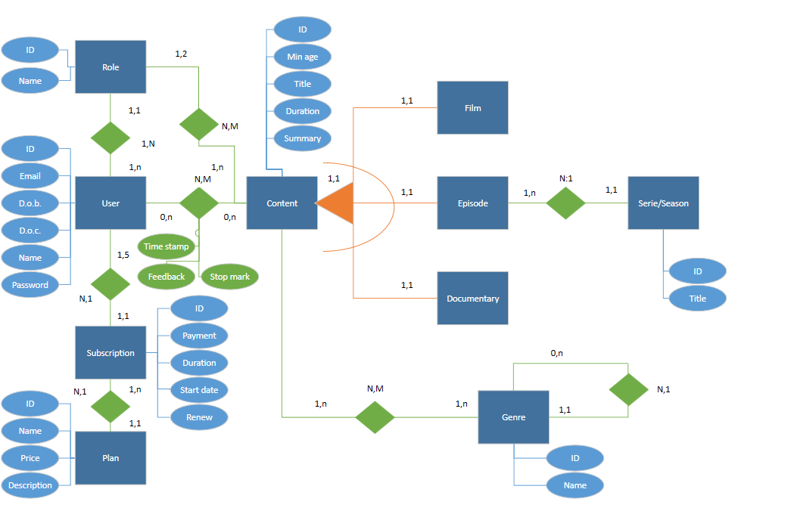

---

### 2.3. Explanation
**Data base explanation:**

We want to store different data for a company that provides a web platform similar to Netflix.

To fulfill this request, we begin with a user entity, through which we will collect the following data: Name, ID, Password, date of creation of the account, date of birth, and email address. We have decided that the person's real name or their ID number will not be stored, due to data privacy policies and because it is not necessary information when creating the website.

Also, each user will acquire a plan to access our platform. The plans can be one of these four: Individual Basic, Individual Premium, Family Basic, and Family Premium. To keep this data correctly, we decided to create two different entities: "subscription" and "plan". By making this division, we can identify which users are on the same family plan. In the plan entity, we will keep this information: Name, ID, Price per month, and description (explaining if the plan has ads...). In the subscription entity, we will keep: ID, Payment method (we will only accept 4 methods: Credit Card, Debit Card, Electronic Wallets, and Cryptocurrencies), Duration (only in months so we can calculate the cost by multiplying duration by price; the maximum duration is 12 months, so the renewal function has a purpose), Start date, and Renewal type (Automatic or Manual). A user must have one subscription, and each subscription will have between 1 and 5 users (family plans have a maximum capacity of 5 users). Each subscription is linked to a plan, and a plan can have multiple subscriptions.

Additionally, each user will have a role, and a role can belong to multiple users. The website will only have 2 different roles, Adults and Kids, which will depend on the date of birth. The role entity will keep the name and ID. This entity is linked to a content entity. A role can allow multiple contents, and a content is allowed by 1 or 2 roles (because there are only 2 different roles); therefore, 18+ content will only be viewed by adults, while children's content can be watched by kids and adults alike.

The content entity will keep this information: Title (if it is an episode, it will also include its corresponding order number), ID, Minimum age required to watch (it can only be -18 or +18), Duration (hours, minutes, and seconds; we will not allow contents longer than 24 hours because Access does not allow storing more than 24 hours in the time function. To fix this, we have decided that if any content exceeds 24 hours, we will split it into parts), and Summary. Also, this entity is linked to "user"; a user can watch no content or multiple contents, and each individual content can be watched by no users or by multiple users. Furthermore, in this relationship, we will keep the stop marker, the feedback, and the timestamp (we will know the exact point where the user stopped watching the content the last time, and what feedback they left. The user can change their feedback as many times as they want or watch the same content multiple times, because the timestamp will be updated with each change).

To continue, we want to store different types of content, so we implemented an ISA relationship with complete exclusivity. Therefore, we have 3 sub-entities: Film, Documentary, and Episodes (we decided to use episodes to prevent cardinality issues). Episodes will be the only entity with distinct attributes, because we want to know which season or series each episode belongs to. To do this, we linked it to another entity called Season/Series, which will keep the ID and the title (if it has more than one season, the title will include "Season 1", "Season 2"...). Each episode belongs to a series/season, and each series/season will have multiple episodes.

To conclude, we will keep the genre and subgenres of the content. To do this, we created another entity called Genre; it will keep the ID and the name, and it will be connected to content. Each content can have multiple genres, and each genre applies to multiple contents. To store the subgenres, we created a recursive relationship. Each genre can have 0 or many subgenres, and each subgenre belongs to only one genre.

---

## 3. Relational model
### 3.1. Relational model
**Plan** : ( <u>IDplan</u>, name, price, description )

**Subscription** : ( <u>IDsubscription</u>, paying method, renew type, duration, date start, <mark>IDplan</mark> )

**Users** : ( <u>IDuser</u>, Name, password, date of birth, date of creation, email, <mark>IDsubscription</mark>, <mark>IDrole</mark> )

**Role** : ( <u>IDrole</u>, Name )

**Content** : ( <u>IDcontent</u>, title, minimun age, duration, sumary )

**Film** : ( <u>IDcontent</u> )

**Documentary** : ( <u>IDcontent</u> )

**Episodes** : ( <u>IDcontent</u>, <mark>IDseason</mark> )

**Serie / season** : ( <u>IDseason</u>, title )

**Content + role** : ( <mark><u>IDrole</u></mark>, <mark><u>IDcontent</u></mark> )

**Content + users** : ( <mark><u>IDusers</u></mark>, <mark><u>IDcontent</u></mark>, <u>time stamp</u>, <u>stop mark</u>, <u>feedback</u> ) 

**Content + Genre** : ( <mark><u>IDGenre</u></mark>, <mark><u>IDcontent</u></mark> )

**Genre** : ( <u>IDgenre</u>, name, <mark>IDgenre(Group)</mark> )

---

## 3. Normalization
### 3.1. Normalization
#### 3.1.1. Atomic values - First normal form
Our Relational model does not have any repeted data, so, our relational model is already in first normal form

#### 3.1.2. Functional dependency - Second normal form
All of the atributes in our relational model are fully dependent on the primary key of each table. Because of that, our relational model is also already in second normal form.

#### 3.1.1. transitive partial dependency - Third normal form
In our relational model could not be find any type of dependency between atributes of the same table. Because of that, our relational model is in third normal form and normalized completely.

---

## 4. Access
### 4.1. Constraints, integrity rules and registered data
#### 4.1.1. Plan

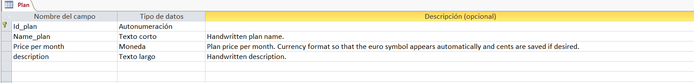

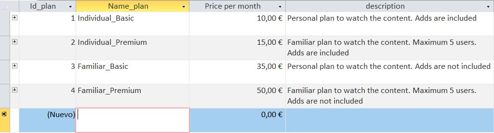

A column for automatically assigning the ID, a column for writing the plan name, a column with the "Currency" format to record the price, and a column for writing the plan description.

#### 4.1.2. Subscription

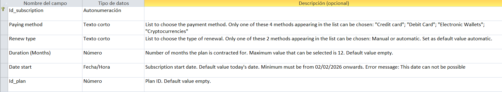

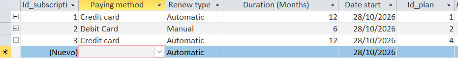

A column for automatically assigning the ID, a column for choosing between four different payment method types with selection restricted to that list, a column for choosing between manual or automatic renewal (the latter being the default value), a column for the subscription duration in months with a maximum value of 12 months, a column for the subscription start date which must be later than 02/02/2026 (hypothetical website creation date), and a final column for the plan's foreign key. We have decided that all default values for the numerical format of this item and all others should be empty to make typing easier. Similarly, the columns storing dates in this item and the rest must default to the date of the day the entry is being written (while still allowing dates from 02/02/2026 onwards) and, if an incorrect date is entered, display this message: “This date can not be possible”.

#### 4.1.3. User

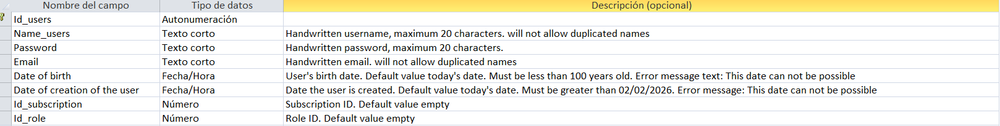

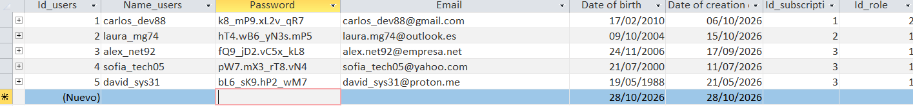

A column for automatically assigning the ID, a column for writing the name (maximum 20 characters), and another for writing the email. In these 2 columns, duplicate names or emails will not be allowed. Another column for the password (maximum 20 characters), another column for the date of birth (02/02/1926 being the minimum date because there will be no people older than 100 years), another column for the account creation date (minimum date 02/02/2026). Another column for the subscription ID and another for the role ID.

#### 4.1.4. Role

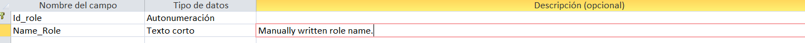

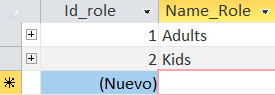

A column for automatically assigning the ID, a column for writing the plan name.

#### 4.1.5. Content + User

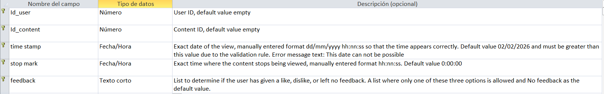

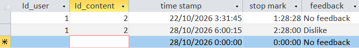

A column for the user ID and another for the content ID. Another column for the timestamp formatted as dd/mm/yyyy hh:nn:ss to also display hours, minutes, and seconds, with a minimum date of 02/02/2026. Another column for the stop mark formatted as hh:nn:ss with a default value of 0:00:00. And a final column to choose between like, dislike, and no feedback, with the latter being the default.

#### 4.1.6. Content + Role

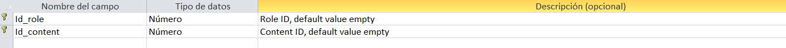

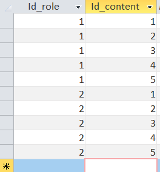

A column to store the content ID and another column for the role

#### 4.1.3. Content

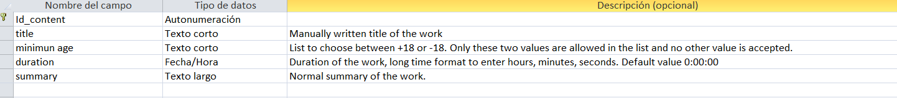

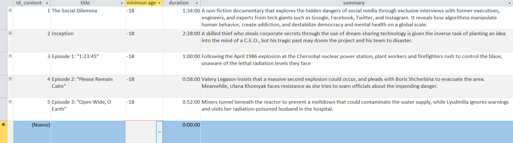

A column for automatically assigning the ID, a column for writing the title of the work, a column to choose from a list between +18 or -18, another column to save the duration in long time format with a default value of 0:00:00, and another column to write the summary.

#### 4.1.3. Film and documentary (They had the same characteristics)

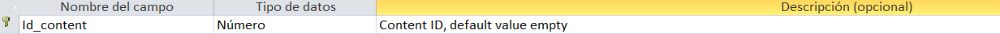

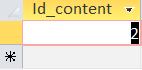

A single column to write the content id

#### 4.1.3. Episode

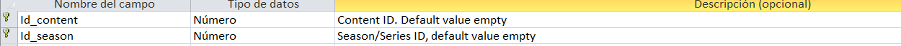

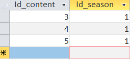

A column to write the content id and other column to write the season id

#### 4.1.3. Serie/season

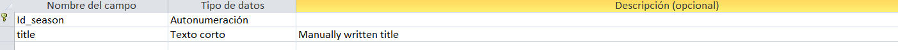

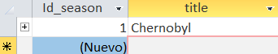

A column for automatically assigning the ID, and another column for writing the series title and which season it is.

#### 4.1.3. Genre

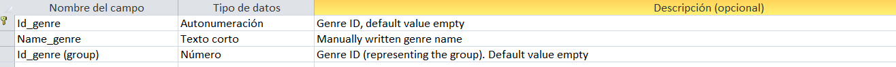

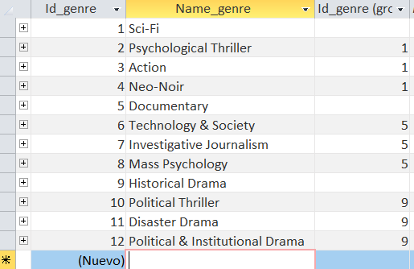

exp

#### 4.1.3. Genre + content

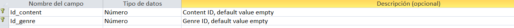

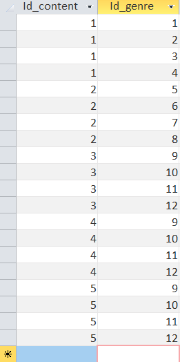

exp