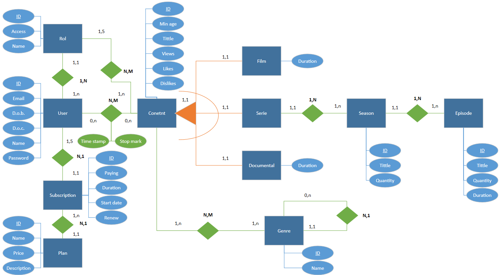

# Digitalizazioa - Proiektuaren Dokumentazioa

## 1. Brainstorming eta ideia orokorra

### 1.1. Brainstorming 
Para empezar con el apartado de base de datos, hemos optado por hacer un brainstorming para aportar la mayor cantidad de ideas para el proyecto. Con este metodo hemos conseguido aportar la mayoria de entidades y de atributos que aparecen en la base de datos final. 
    
### 1.2. Ideia orokorra 
Una vez con la fase de brainstorming completada, nos dispusimos a enlazar todo lo optenido de la forma mas optima posible y a la vez adaptandola a nuestra idea de pagina web. En este paso diseñamos el primer esquema para que fuese lo mas comprensible y a la vez facil de crear posible. Con esto hecho, al crear nuestra E/R esquema nos facilitara el proceso.

---

## 2. E/R esquema

### 2.1. Diseño definitivo E/R esquema
Con el trabajo muy facilitado gracias al anterior paso, nuestro trabajo se redujo a tres sencillos pasos. El primer paso fue reducir el esquema para adaptarlo a nuestras necesidades reales. Aqui descartamos todo el apartado de la produccion y la entidad "Komentario" para que el diseño final no se extendiese en exceso. El segundo paso fue dibujar el esquema en papel con los atributos figurando ya en el esquema, colocar las cardinales y usar el codigo preciso para todo lo anterior. El tercer y ultimo paso fue corregir distintos fallos que encontramos a lo largo del proceso para tener el boceto definitivo.

### 2.2. Digitalizar el E/R esquema
Con un boceto ya definido, decidimos crear una version digitalizada para pulir aun mas nuestro trabajo. Para esta tarea decidimos usar la app Visio. En ella la tarea solo fue ir pasando lo que habia en el papel, dibujado a lapiz, a la app usando sus diferentes figuras y conexiones. Para que el diseño quedara aun mas claro, usamos diferentes colores para cada elemento (por ejemplo: Berde-relaciones)

---

### 2.2. IT eta OT Teknologiak
Eraldaketa digitalean bi teknologia-talde nagusi bereizten dira:

* **IT (Informazioaren Teknologiak):** Datuak prozesatzera eta informazioa kudeatzera bideratutako tresna digitalak dira. Enpresaren "garuna" bezalakoak dira (softwareak, datu-baseak, sareak).
* **OT (Operazio Teknologiak):** Prozesu fisikoak kontrolatu eta automatizatzen dituzten gailuak dira. Enpresaren "besoak eta hankak" dira (sentsoreak, beso robotikoak, PLCak, SCADA sistemak).

Bi ingurune hauen arteko integrazioak (IT/OT konbergentzia) mantentze prediktiboa, ekoizpen malgua eta denbora errealeko kontrola hobetzea lortzen du.

---

### 2.3. Teknologia Gaitzaile Digitalak (TGD / THD)
Eraldaketa digitala ahalbidetzen duten eta gaitasun zein negozio-eredu berriak garatzen laguntzen duten puntako teknologiak dira.

**TGD nagusiak:**
1. **Gauzen Interneta (IoT):** Gailu fisikoak Internetera konektatzea.
2. **Adimen Artifiziala (IA):** Makinek ikasi eta erabakiak hartzeko gaitasuna.
3. **Big Data:** Datu-bolumen handien analisia.
4. **Cloud Computing:** Konputazioa eta biltegiratzea hodeian.
5. **Zibersegurtasuna:** Sistemak eta datuak mehatxuetatik babestea.
6. **Errealitate Birtuala eta Areagotua (VR/AR):** Esperientzia murgiltzaileak.
7. **Beste batzuk:** Blockchain, 5G, Robotika, 3D Inprimaketa eta Biometria.

**Ezaugarri nagusiak:** Moldakortasuna, automatizazioa, interkonexioa, eskalagarritasuna eta eraginkortasunaren hobekuntza.

---

### 2.4. Cloudean Oinarritutako Sistemak (Cloud Computing)
Cloud computing-a Internet bidez eskuragarri dauden baliabide informatikoak (zerbitzariak, biltegiratzea, aplikazioak) urrunetik erabiltzeko eredua da, azpiegitura fisiko lokal baten mende egon gabe.

**Ezaugarriak eta Mailak:**
* **Eredu Tradizionala vs Hodeia:** Eredu tradizionalean datuak eta programak gailu lokalean instalatzen eta gordetzen dira; hodeian, berriz, edozein gailutatik atzitu daitezke Internet bidez, biltegiratze lokala muga izan gabe.
* **Hodei motak:** Publikoa, Pribatua eta Hibridoa.
* **Zerbitzu Ereduak (Kontenedoreak):**
  * **IaaS (Infrastructure as a Service):** Azpiegitura birtuala alokatzea (adib. Azure VM, Amazon EC2).
  * **PaaS (Platform as a Service):** Aplikazioak garatzeko plataforma (adib. Google App Engine).
  * **SaaS (Software as a Service):** Erabiltzeko prest dauden software-aplikazioak (adib. Google Workspace, Microsoft 365).
* **Eboluzioa (Fog / Edge / Mist Computing):** Hodeiko latentzia eta banda-zabalera hobetzeko, prozesamendua datu-iturritik gertuago egiteko garatutako teknologiak.