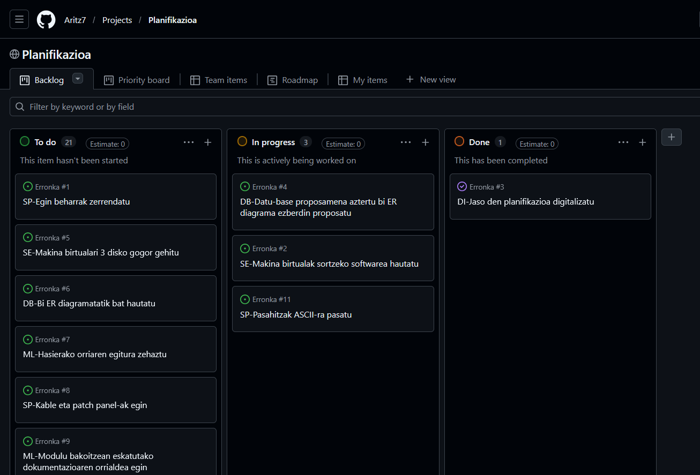
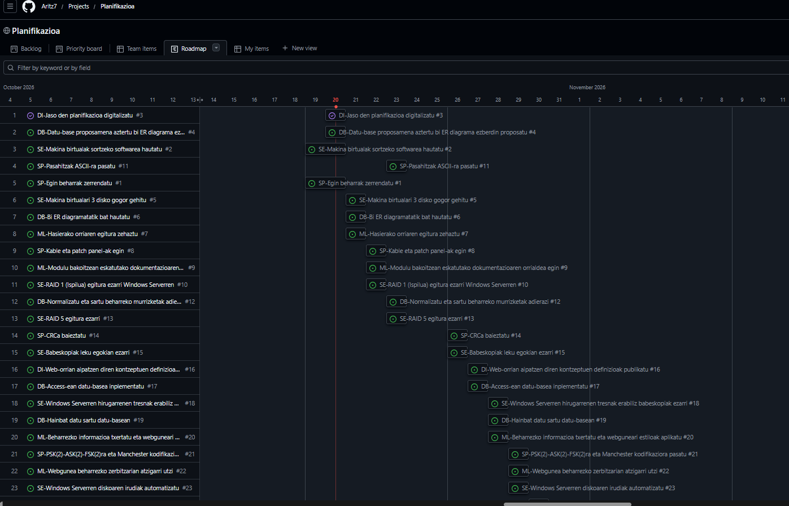

# Digitalizazioa - Proiektuaren Dokumentazioa

## 1. Planifikazioaren Digitalizazioa

Proiektu honen lehenengo urratsetan, lan-karga eta atazak modu eraginkorrean kudeatzeko, hasierako planifikazioa digitalizatu dugu. Horretarako, **GitHub Projects** tresna erabili dugu tablero birtual bat sortuz. Tablero honetan, ataza bakoitza bere egoeraren arabera (*To do*, *In progress*, *Done*) eta dagokion asignaturaren arabera antolatu da.
    

---

## 2. Digitalizazioaren Oinarrizko Kontzeptuak

### 2.1. Digitalizazioa 
**Digitalizazioa** prozesu, produktu eta zerbitzu tradizionalak eraldatzeko prozesua da, teknologia digitalen erabilera integralaren bidez. Ez da soilik lan-zereginak informatizatzea edo paperak ordenagailura pasatzea, baizik eta erakunde baten funtzionamendua, ekoizpen-eredua eta erabakiak hartzeko modua errotik birdefinitzea.

### Abantailak eta Enpresa-Eragina
* **Eraginkortasuna eta Zehaztasuna:** Akats giza-faktoreak gutxitzen ditu eta baliabideen erabilera optimizatzen du.
* **Erabakiak Denbora Errealean:** Datuen analitikari esker, enpresak berehala egokitu daitezke merkatuko edo ekoizpeneko aldaketetara.
* **Negozio-Eredu Berriak:** Zerbitzu digital berriak, harpidetza-sistemak eta pertsonalizaturiko produktuak sortzea ahalbidetzen du.
* **Lan-Ingurunearen Eraldaketa:** Lanpostu teknologiko berriak sortzen ditu eta barne-komunikazio nahiz elkarlana azkartzen ditu.

### Eragina Ekoizpen-Sektoreetan
* **Lehen Sektorea (Nekazaritza/Abeltzaintza):** Sentsore bidezko ureztatze automatizatua, droneen bidezko soro-azterketa eta abereen jarraipen digitala.
* **Bigarren Sektorea (Industria/Fabrikazioa):** 4.0 Industria, robotika kolaboratiboa, ekoizpen-kate automatizatuak eta mantentze prediktiboa.
* **Hirugarren Sektorea (Zerbitzuak/Merkataritza):** Merkataritza elektronikoa (e-commerce), bezeroen kudeaketa digitala (CRM) eta logistika adimenduna.
---

### 2.2. IT eta OT Teknologiak
Eraldaketa digitalean bi teknologia-talde nagusi bereizten dira:

* **IT (Informazioaren Teknologiak):** 
Datuak prozesatzera, biltegiratzera eta informazioa kudeatzera bideratutako tresna digitalak dira. Enpresaren **"garuna"** bezala ezagutzen da.

* **Funtzio nagusia:** Enpresako informazio-fluxua, komunikazioa eta negozio-kudeaketa bideratzea.
* **Adibideak:**
  * **ERP (Enterprise Resource Planning):** SAP edo Odoo bezalako kudeaketa-softwareak.
  * **CRM (Customer Relationship Management):** Bezeroekiko harremanak kudeatzeko sistemak.
  * **Datu-baseak eta Zerbitzariak:** PostgreSQL, MySQL, Hodeiko zerbitzariak.
  * **Sare-Azpiegitura:** Bideratzaileak (routers), Switch-ak eta Enpresa-WIFIak.

* **OT (Operazio Teknologiak):** 
Prozesu fisikoak zuzenean kontrolatu, monitorizatu eta automatizatzen dituzten gailu hardware zein softwareak dira. Enpresaren **"besoak eta hankak"** dira.

* **Funtzio nagusia:** Mundu fisikoan eragitea (mugitu, moztu, tenperatura erregulatu, balbulak ireki).
* **Adibideak:**
  * **PLC (Automata Programagarria):** Industria-makinak kontrolatzen dituen ordenagailu txikia.
  * **SCADA Sistemak:** Lantegiko prozesu fisikoak denbora errealean ikuskatzeko eta kontrolatzeko interfazeak.
  * **Sentsore Industrialak:** Tenperatura, presioa edo presentzia hautematen duten gailuak.
  * **Beso Robotikoak eta Aktuatzaileak:** Produktuak mugitu, kaxak kargatu edo soldadura lanak egiten dituzten robotak.

---

### 2.3. Teknologia Gaitzaile Digitalak (TGD / THD)

Teknologia Gaitzaile Digitalak (TGD) eraldaketa digitala ahalbidetzen duten eta gaitasun zein negozio-eredu berriak garatzen laguntzen duten puntako teknologiak dira.

**11 TGD Nagusiak:**

1. **Gauzen Interneta (IoT - Internet of Things):** 
   * Gailu eta sentsore fisikoak Internetera konektatzea datuak denbora errealean biltzeko eta trukatzeko.
   * *Adibidea:* Landareen hezetasuna neurtzen duten sentsoreak edo etxeko termostato adimendunak.

2. **Adimen Artifiziala (IA - Artificial Intelligence):** 
   * Makinek eta sistemek datuetatik ikasi, ereduak hauteman eta erabakiak autonomoki hartzeko gaitasuna.
   * *Adibidea:* Bezeroei erantzuten dieten txatbotak edo GitHub Copilot bezalako kode-laguntzaileak.

3. **Big Data eta Datuen Analitika:** 
   * Ohiko software bidez kudeatu ezin diren datu-bolumen handiak biltzea, prozesatzea eta aztertzea.
   * *Adibidea:* Sare sozialetako milioika erabiltzaileren joerak aztertzea gomendioak egiteko.

4. **Cloud Computing (Hodeiko Konputazioa):** 
   * Konputazio-baliabideak (zerbitzariak, biltegiratzea, softwarea) Internet bidez eskatuz gero atzitzea.
   * *Adibidea:* Google Drive, GitHub edo AWS zerbitzariak.

5. **Zibersegurtasuna:** 
   * Informazio-sistemak, sareak, gailuak eta datuak baimenik gabeko sarbideetatik zein ziber-mehatxuetatik babestea.
   * *Adibidea:* Bi faktoreko autentifikazioa (2FA) eta datu-enkriptazioa.

6. **Errealitate Birtuala eta Areagotua (VR/AR):** 
   * **VR:** Ingurune %100 simulatua eta murgiltzailea sortzea.
   * **AR:** Mundu errealaren gainean informazio edo elementu digitalak gainjartzea.
   * *Adibidea:* Kirurgialarien entrenamendurako simuladoreak (VR) edo mantentze-lanetarako gida-bisualak (AR).

7. **Blockchain (Katea-Blokeak):** 
   * Datu-base deszentralizatua eta aldaezina, transakzioak modu seguruan eta bitartekaririk gabe erregistratzeko.
   * *Adibidea:* Kriptomonetak edo kontratu adimendunak (*smart contracts*).

8. **5G eta Konektibitate Aurreratua:** 
   * Abiadura handiko, edukiera zabaleko eta latentzia oso txikiko haririk gabeko sareak.
   * *Adibidea:* Kirurgia urrunetik egitea edo ibilgailu autonomoen arteko berehalako komunikazioa.

9. **Robotika Aurreratua:** 
   * Zeregin fisiko konplexuak automatizatzen dituzten robot autonomo edo kolaboratiboak (*cobots*).
   * *Adibidea:* Biltegietan kaxak garraiatzen dituzten robot autonomoak.

10. **3D Inprimaketa (Fabrikazio Gehitua):** 
    * Eredu digital baten bidez objektu fisiko hiru dimentsionalak geruzaz geruza sortzeko teknologia.
    * *Adibidea:* Protezi mediko pertsonalizatuak edo industriarako ordezko piezak fabrikatzea.

11. **Biometria:** 
    * Pertsonak beren ezaugarri fisiko edo portaerazkoen bidez (hatz-marka, aurpegia, irisa) identifikatzeko teknologia.
    * *Adibidea:* Mugikorra aurpegiarekin desblokeatzea edo eraikinetako sarbide-kontrola.

---

**TGD-en Ezaugarri Nagusiak:**
* **Interkonexioa:** Gailu eta sistema guztiak beren artean komunikatzeko gaitasuna.
* **Automatizazioa:** Giza esku-hartze gutxirekin prozesu konplexuak egitea.
* **Eskalagarritasuna:** Enpresaren beharren arabera baliabideak erraz handitzeko edo txikitzeko ahalmena.
* **Moldakortasuna:** Negozio-eredu berrietara eta merkatuaren aldaketetara azkar egokitzea.

---

### 2.4. Cloudean Oinarritutako Sistemak (Cloud Computing)
Cloud computing-a Internet bidez eskuragarri dauden baliabide informatikoak (zerbitzariak, biltegiratzea, aplikazioak) urrunetik erabiltzeko eredua da, azpiegitura fisiko lokal baten mende egon gabe.

**Ezaugarriak eta Mailak:**
* **Eredu Tradizionala vs Hodeia:** Eredu tradizionalean datuak eta programak gailu lokalean instalatzen eta gordetzen dira; hodeian, berriz, edozein gailutatik atzitu daitezke Internet bidez, biltegiratze lokala muga izan gabe.
* **Hodei motak:** Publikoa, Pribatua eta Hibridoa.
* **Zerbitzu Ereduak (Kontenedoreak):**
  * **IaaS (Infrastructure as a Service):** Azpiegitura birtuala alokatzea (adib. Azure VM, Amazon EC2).
  * **PaaS (Platform as a Service):** Aplikazioak garatzeko plataforma (adib. Google App Engine).
  * **SaaS (Software as a Service):** Erabiltzeko prest dauden software-aplikazioak (adib. Google Workspace, Microsoft 365).
* **Eboluzioa (Fog / Edge / Mist Computing):** Hodeiko latentzia eta banda-zabalera hobetzeko, prozesamendua datu-iturritik gertuago egiteko garatutako teknologiak.

