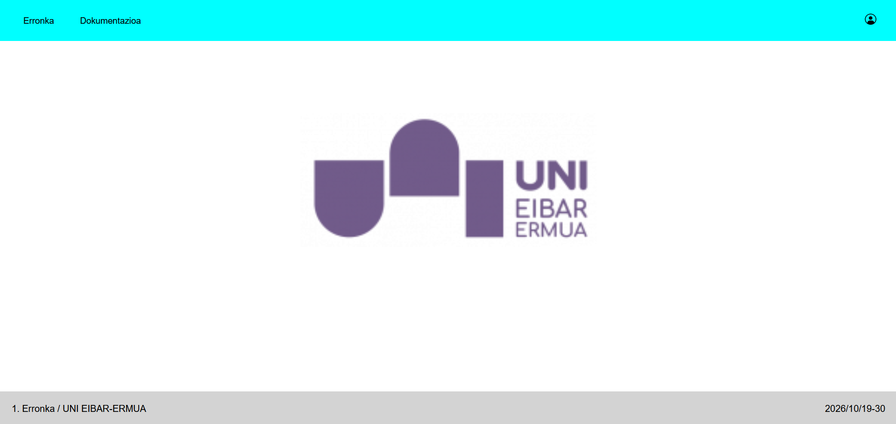
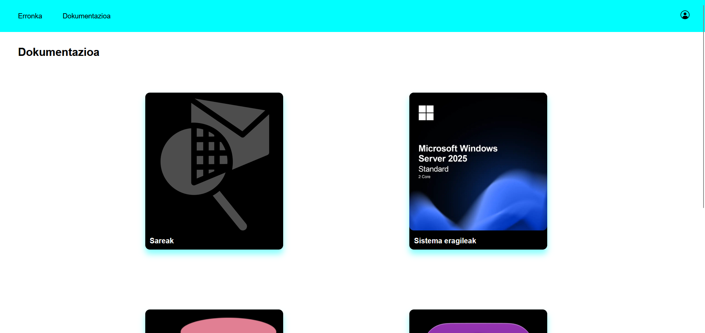

# Web Orriaren Garapena - Proiektuaren Dokumentazioa

## 1. Weborriaren Garapena

Proiektu honen weborria **HTML5** eta **CSS3** erabiliz garatu dugu, beste liburutegi edo framework-ik gabe. Weborriak bi fitxategi nagusi ditu: `index.html` (egitura) eta `style.css` (itxura).




---

## 2. Visual Studio Code

### 2.1. HTML

HTML erabili dugu orriaren egitura definitzeko. Erabilitako elementu eta atributu nagusiak:

- **Fitxategi estiloa lotzeako:** `<link rel="stylesheet" href="style.css">`.
- **Edukiontzien antolaketa:** `<div>` elementuak (`navbar` eta `footer`).
- **Nabigazioa:** `<ul>`, `<li>` eta `<a>` elementuak, orri desberdinak lotzeko (`index.html`, `dokumentazioa.html`, `Saioahasi.html`).
- **Irudiak:** `` elementua logoa eta erabiltzaile-ikonoa txertatzeko.
- **Klaseak:** `class` atributua elementuei estiloa emateko (`link`, `navbar1`, `erabiltzailea`, `logo`, `footer`).

---

### 2.2. CSS

CSS erabili dugu orriaren diseinua eta itxura definitzeko.

**Erabilitako propietate nagusiak:**

- **Testua:** `font-family`, `font-size`, `text-decoration`, `color`.
- **Kutxa-eredua:** `margin`, `padding`, `height`, `width`, `box-sizing`.
- **Koloreak:** `background-color`, `rgb()` eta `color`.
- **Itxura:** `border-radius`, `box-shadow`.
- **Kokapena:** `position`, `left`, `right`.
- **Diseinua:** `display`, `flex-direction`, `justify-content`, `align-items`.

**Selektoreak:**

1. **Etiketa-selektoreak:** `body`.
2. **Klase-selektoreak:** `.navbar`, `.link`, `.navbar1`, `.erabiltzailea`, `.logo`, `.footer`.
3. **Pseudo-klaseak:** `:hover`, saguaren gainean jartzean efektuak sortzeko.

---

### 2.3. Flexbox

Elementuak antolatzeko **Flexbox** diseinu-sistema erabili dugu.

- **`body`:** `display: flex` eta `flex-direction: column`, elementuak zutabean antolatzeko.
- **`.navbar`:** `justify-content: space-between` eta `align-items: center`, loturak ezkerrean eta erabiltzaile-ikonoa eskuinean jartzeko, bertikalki zentratuta.
- **`.footer`:** `flex-direction: row` eta `justify-content: space-between`.
- **`margin-top: auto`** footer-ean, orriaren behealdean mantentzeko.
- **`min-height: 100vh`** `body`-n, orriak pantailaren altuera osoa har dezan.

---

### 2.4. Interaktibitatea eta Efektuak

JavaScript erabili gabe, **CSS-ko `:hover` pseudo-klasea** erabili dugu interaktibitatea lortzeko:

- **Nabigazio-loturak (`.navbar1:hover`):** itzala (`box-shadow`) eta kolore argiagoa.
- **Erabiltzaile-ikonoa (`.erabiltzailea:hover`):** efektu bera.

---

### 2.5. Fitxategien Antolaketa

```
1-Erronka-WEB-ORRIA/
├── index.html
├── dokumentazioa.html
|   ├── sareak.html
|   |   └── style_sareak.css
|   ├── sistemaeragileak.html
|   |   └── style_sistemaeragileak.css
|   ├── datubaseak.html
|   |   └── style_datubaseak.css
|   └── digitalizazioa.html
|       └── style_digitalizazioa.css
├── Saioahasi.html
|   |   └── style_saioahasi.css
|   └── Erregistroa.html
|       └── style_erregistroa.css
├── style.css
└── img/
    ├── erabiltzailea.png
    └── infogramak-UNI-45-e1620890341119-1.png
