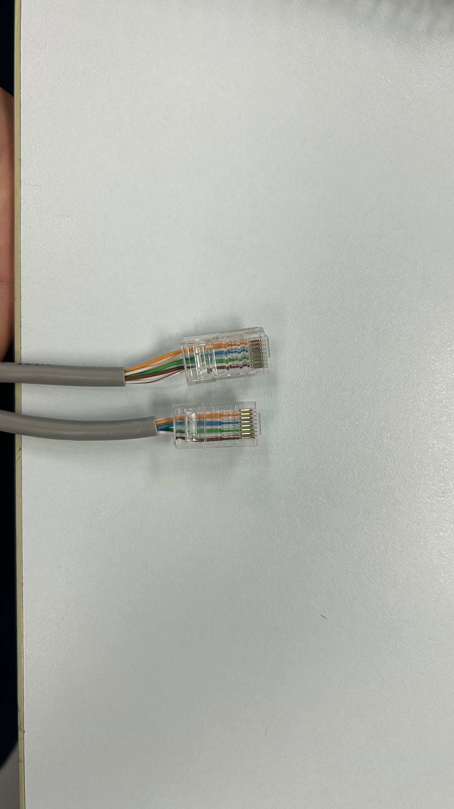
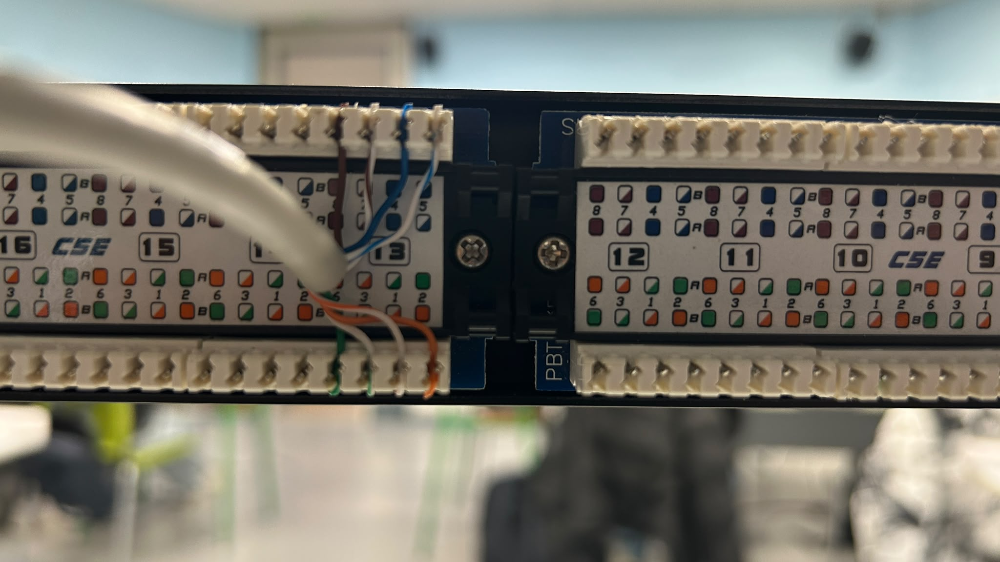
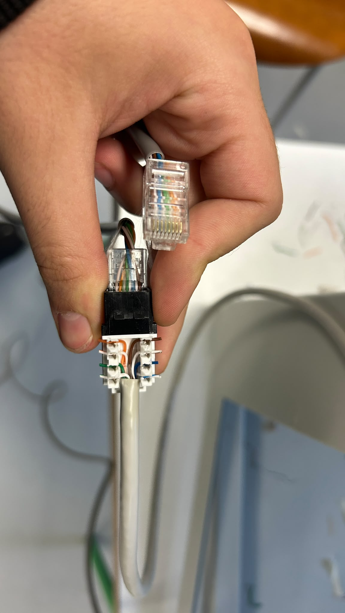
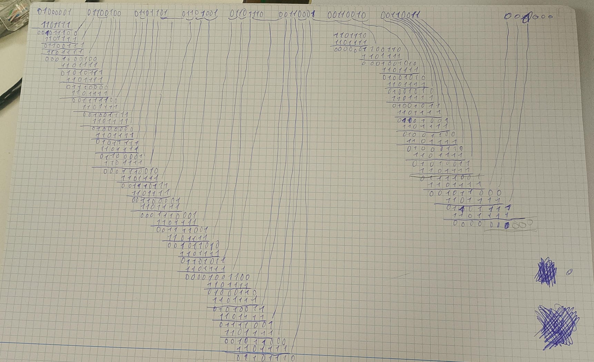
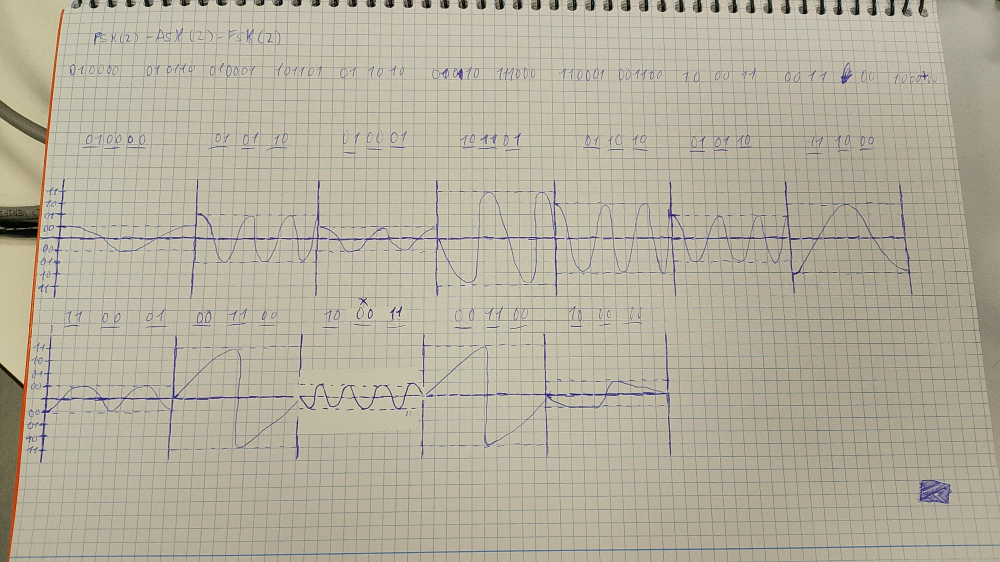
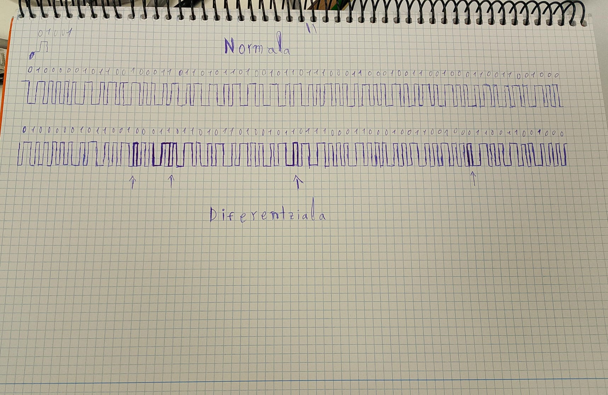
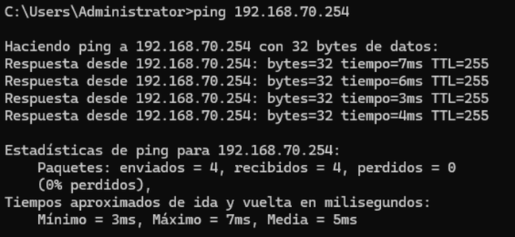
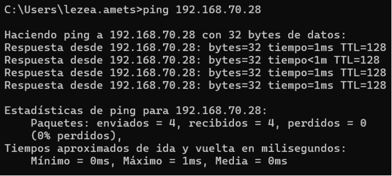
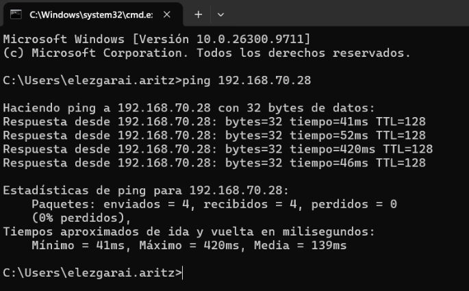

# Sareak - Sareen Planifikazioa eta Kodifikazioa

Atal honetan, Sareak moduluan landutako plangintza, kableak lortzeko prozesua eta informazioaren kodifikazio-lanak azaltzen dira.

---

## 1. Materiala, Kableak eta Patch Panela
Prozesuari hasiera emateko, beharrezko materialak eta kableak lortu eta kokatu ditugu (*lortu/kokatu*), azpiegitura fisikoaren oinarriak ezartzeko.

Nabarmentzekoa da Ethernet kableak prestatzeko prozesua ez zela guretzat berria, lehenago ere klasean praktikatuta genuelako. Aurretik, kable zuzena eta kable gurutzatua egiteko aukera izan genuen, eta esperientzia hori oso erabilgarria izan zaigu zeregin honetarako.

Horren ondoren, kableatze-lanak osatu ditugu:
- **Patch Panel-ean kableatzea:** Kableak patch panel-ean Behar bezala konektatu eta antolatu ditugu.

- **Kable emea (RJ45 Keystone):** Era berean, kableatze hori kable/konektore eme bati lotu zaio, sare-puntuaren lotura fisikoa egoki uzteko.

---

## 2. Pasahitza eta ASCII Biherketa
Proiekturako **`admin123`** pasahitza aukeratu dugu. Pasahitz hau hautatzearen arrazoia sinplea da: erraz gogoratzen da eta erraza da karakterez karaktere kode bitarrera igarotzeko.

Pasahitza binariora pasatzeko, **ASCII** taula erabili dugu. Taula honek karaktere bakoitzari zenbaki bat esleitzen dio, eta zenbaki hori 8 biteko talde bitarrean adierazten da.

* **Adibidea (nola pasatzen den letra bat binariora):**
  'a' letra ASCII kodera eramanda hamartarrean `65` da. Zenbaki hori binariora igarotzen badugu: 65 = --> 01000001
  Horrela, 'a' letraren adierazpen bitarra `01000001` dela lortzen dugu.

* **a** --> `01000001`
* **d** --> `01100100`
* **m** --> `01101101`
* **i** --> `01101001`
* **n** --> `01101110`
* **1** --> `00110001`
* **2** --> `00110010`
* **3** --> `00110011`

---

## 3. CRC Kalkulua eta Gehitzea
Transmisioan zehar datuak aldatu edo hondatu ez direla egiaztatzeko (datuen osotasuna eta erroreen detekzioa bermatzeko), aukeratutako pasahitz bitarrari **CRC-6** (*Cyclic Redundancy Check*) algoritmoa aplikatu diogu.

Teknika honek polinomio sortzaile bat erabiltzen du kate bitarra zatitzeko, eta lortzen den hondarra transmisioaren amaieran gehitzen zaio datu-kategileari. Horrela, harreragileak berriro zatiketa bera eginez badaki errore bat egon den ala ez.

- **Kalkulatutako eta gehitutako CRC kodea:** `001000`

Prozesu honen bidez, trama osoa (ASCII pasahitza + amaierako CRC-a) transmisio-biderako prest utzi dugu.

---

## 4. Modulazio Teknologiak
Lortutako kate osoa (ASCII testua + CRC) modulazio digital **PSK(2) ASK(2) FSK(2)**-ra pasatu dugu:

Seinale digitalak (bitak) seinale analogiko bihurtzeko eta garraiatzeko, hiru modulazio-teknika nagusiak erabili ditugu. Modulazio bakoitzak seinalearen uhin eramailearen ezaugarri eri bat aldatzen du bit bakoitzaren arabera:

* **ASK:** Seinalearen "altuera" aldatzen du.
* **PSK:** Seinalearen norabidea aldatzen du.
* **FSK:** Seinalearen uhin kopurua aldatzen du.

### Nola igarotzen da bit-kate bat (adibidez `010000`) modulazio bakoitzera?
Aukeratutako `010000` adibidearekin ikus dezakegu nola irudikatzen den seinalea:

1. **PSK:**
   - Bit bikote bakoitzak (adibidez `01`) norabide zehatz bat ezartzen dio seinaleari. (Adibidez, `01` zenbakiaren norabidea de goitikan hastea eta bukatzea)

2. **ASK:**
   - Bit bikote bakoitzak (`00`, `01`, `10`, `11`) altuera graduatu bat du. Adibidez, kasu honetan `00` da, eta zenbaki hura altuera txikiena dio.
3. **FSK:**
   - Bit bikote bakoitzak uhin koupuru ezberdin bat du.
   - `00` kasuan uhin-kopuru bakarra dio.

---

## 5. Linea-Kodifikazioak (Manchester)
Azkenik, seinale digital garbia linea fisiko bidetik garraiatzeko eta harreragilearen erlojua denbora errealean sinkronizatuta mantentzeko, **Manchester** linea-kodifikazioak erabili ditugu. Kodifikazio mota honek bit bakoitzaren erdian trantsizio bat egotea bermatu egiten du beti.

Horrela funtzionatzen dute bi aldaerek:

* **Manchester Normala:** Bitaren erdiko trantsizioaren norabideak definitzen du bitaren balioa:
  - **`1` bita:** Behetik gora doa (seinalea **igo** egiten da).
  - **`0` bita:** Goitik behera doa (seinalea **jaitsi** egiten da).

* **Manchester Diferentziala:** Bitaren hasieran trantsiziorik dagoen ala ez begiratzen da balioa zehazteko (trantsizioak norabide aldaketa dakar):
  - **`1` bita:** Norabidea **aldatzen da**.
  - **`0` bita:** Norabidea **mantentzen da**.

---

## 6. Kommutadoreen eta lan-estazioen konexioa
Gailueen arteko konexioa frogatzeko ping komandoa erabili dugu 'cmd'-etik.
- **1.** VirtualBox-etik ordenagailura:

- **2.** Ordenagailutik VirtualBox-era:

- **3.** Sarean dagoen beste ordenagialu batetik VirtualBox-era:

