# Sistema eragileak ezartzea

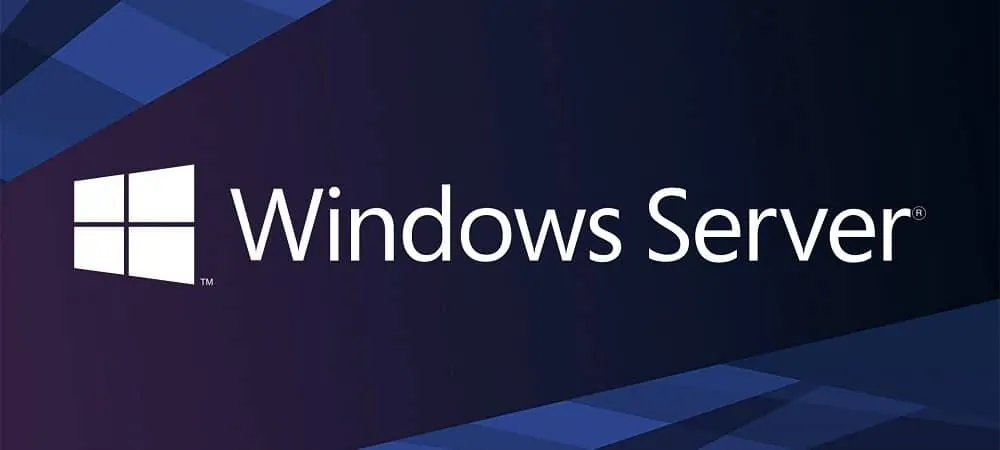

# Aurkibidea

- [1. Lehen atala](#1-lehen-atala)
- [2. Sistemaren instalazioa](#2-sistemaren-instalazioa)
- [3. Oinarrizko konfigurazioak](#3-oinarrizko-konfigurazioak)
  - [IP](#ip)
  - [Erabiltzaileak eta taldeak sortzea](#erabiltzaileak-eta-taldeak-sortzea)
  - [Erabiltzaileak eta taldeak administratzea](#erabiltzaileak-eta-taldeak-administratzea)
  - [Kuotak ezartzea](#kuotak-ezartzea)
  - [RAID](#raid)
  - [Babeskopia](#babeskopia)
- [4. Zerbitzuak](#4-zerbitzuak)
  - [Instalazioak](#instalazioak)
  - [DNS](#dns)
  - [IIS](#iis)

# 1. Lehen atala

### Zer da sistema informatiko bat?

Sistema informatiko bat informazioa jaso, gorde, prozesatu eta komunikatzeko elkarrekin lan egiten duten elementu fisikoen, programen eta datuen multzoa da. Hiru atal nagusi ditu:

- **Hardwarea**: sistemaren osagai fisikoak (prozesadorea, memoria, disko gogorra, periferikoak…). Datuak prozesatu, gorde eta transmititzen ditu.
- **Softwarea**: programa eta aplikazioen multzoa (sistema eragilea, aplikazioak, utilitateak). Hardwareari zer egin behar duen esaten dio.
- **Pertsonak** (giza elementua): sistema erabili, garatu eta mantentzen dutenak (erabiltzaileak, programatzaileak, administratzaileak).

### Zer da sistema eragilea?

Hardwarearen, erabiltzaileen eta aplikazioen arteko bitartekaria den softwarea da, eta funtzio hauek ditu:

1. **Prozesuen kudeaketa**: planifikazioa, sinkronizazioa, komunikazioa.
2. **Memoriaren kudeaketa**: esleipena, memoria birtuala, babesa.
3. **Fitxategi-sistemaren kudeaketa**: fitxategiak eta direktorioak antolatu, atzitu eta babestu.
4. **Sarrera/irteeren kudeaketa**: gailuak kontrolatu (driverren bidez).
5. **Segurtasuna eta babesa**: erabiltzaileen autentifikazioa, baimenak.
6. **Erabiltzaile-interfazea**: komando-lerroa (CLI) edo interfaze grafikoa (GUI).
7. **Sareen eta baliabideen kudeaketa**: komunikazioa eta erabilera-kontabilitatea.

Sistema eragileak elkarrengandik oso ezberdinak izan daitezke, baina guztiek arkitektura hau jarraitzen dute:

1. **Nukleoa (kernel)**: sistemaren muina; hardwarearekin zuzenean lan egiten du (prozesuak, memoria, gailuak, sistema-deiak).
2. **Sistema-deiak (API)**: aplikazioek kernelaren zerbitzuak eskatzeko bidea.
3. **Shell edo interfazea**: erabiltzailearen eta kernelaren arteko komunikazioa.
4. **Aplikazioak eta erabiltzailea**.

### Sistema eragile ezberdinak

|  | **Windows** | **macOS** | **Linux (Ubuntu, Debian, RHEL…)** | **Android** | **iOS** |
|---|---|---|---|---|---|
| **Bertsio nagusiak** | Windows 10 (euskarri amaitua), Windows 11, Windows Server | Bertsio berriena: macOS 26 "Tahoe" eta ondorengoak | Ubuntu LTS (24.04, 26.04), Debian stable, RHEL | Android 14, 15, 16… | iOS 26 eta ondorengoak |
| **Lizentzia** | Jabedunekoa, ordainpekoa (OEM, retail, bolumen-lizentziak) | Jabedunekoa, Apple ekipoekin dator, eguneraketak doakoak | Software librea (GPL), doakoa. RHEL/SUSE: ordainpeko euskarria | AOSP (Apache 2.0) irekia, baina Google zerbitzuak lizentziapean | Itxia, Apple gailuetan soilik |
| **Gutxieneko eskakizunak** | 64 biteko CPU, 4 GB RAM, 64 GB disko, TPM 2.0, UEFI | Apple Silicon edo Intel Mac bateragarriak, 8 GB RAM gomendatua | Oso aldakorra: Ubuntu Desktop ≈ 4 GB RAM, 25 GB. Banaketa arinak: 512 MB-ekin | Fabrikatzailearen hardwarea (ARM batez ere) | Apple gailu bateragarriak |
| **Ezaugarriak** | Hardware- eta software-bateragarritasun handia, GUI intuitiboa, joko-euskarria | Diseinu-ekosistema integratua, UNIX oinarria, segurtasun ona | Egonkorra, segurua, pertsonalizagarria, kontsola indartsua, kodea irekia | Ukitzeko interfazea, aplikazio-denda zabala, pertsonalizagarria | Itxia, segurua, errendimendu optimizatua, eguneraketa luzeak |
| **Aplikazio-eremuak** | Etxea, bulegoa, enpresak, jokoak | Diseinua, ekoizpen multimedia, garapena | Zerbitzariak, hodeia, garapena, ikerketa, IoT, superkonputazioa | Mugikorrak, tabletak, telebistak, auto-sistemak | Mugikorrak eta tabletak (iPhone, iPad) |

# 2. Sistemaren instalazioa

Hasteko, zerbitzariarentzat zein software erabiliko dugun aukeratuko dugu. Makina birtualean dena egingo dugunez, VirtualBox erabiliko dugu, Windows Server 2025 Standard batekin.

Honekin hasteko, VirtualBox-en sartu eta makina berri bat sortuko dugu.

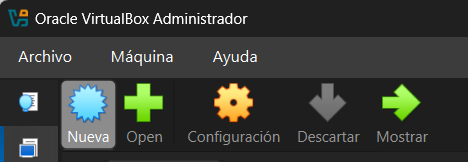

Lehenik, makinaren izena, ISO-a eta bertsioa aukeratu beharko ditugu.

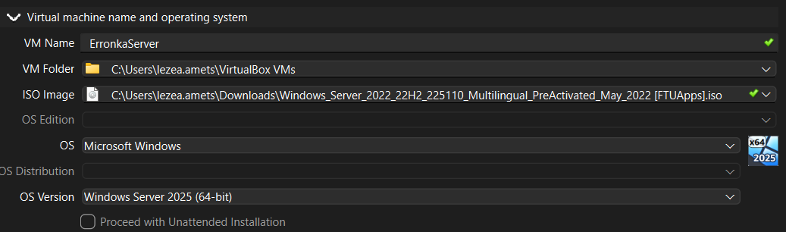

Gero, hardware-konfigurazioak ezarri behar dira, hala nola RAM-a, CPU-a eta biltegiratzea.

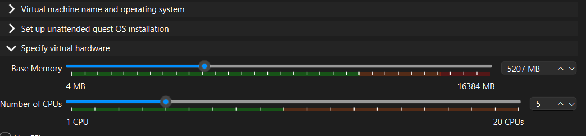

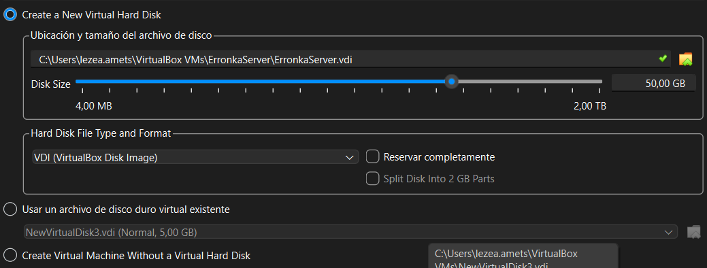

Hau eginda, makina abiarazteko prest egongo da.

Abiarazi ondoren, lehenengo gauza hizkuntza aukeratzea galdetuko dizu (ISO-aren arabera aldatzen da).

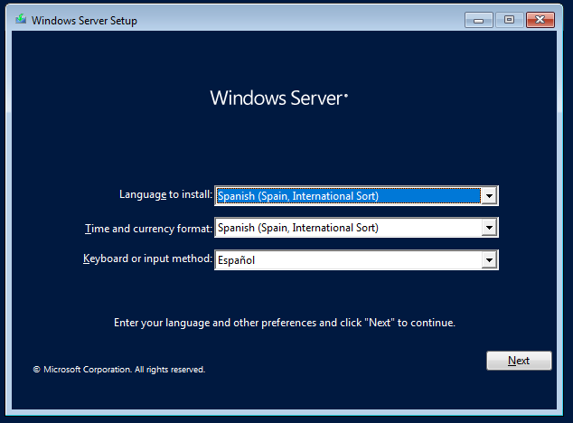

Gero bertsioa aukeratuko dugu; gure kasuan, Standard bertsioa.

Bertsio bakoitzak bere eskakizunak eta ezberdintasunak ditu. Core bertsioak, alde batetik, ez dauka interfaze grafikorik, terminal huts bat baizik. Datacenter bertsioa askoz garestiagoa da, eta tarifa gailuak dituen nukleo bakoitzeko ordaintzen da, baina ez dauka mugarik birtualizazioan edo kudea dezakeen hardware kantitatean. Standard bertsioa, berriz, lizentzia ordaindu eta kito.

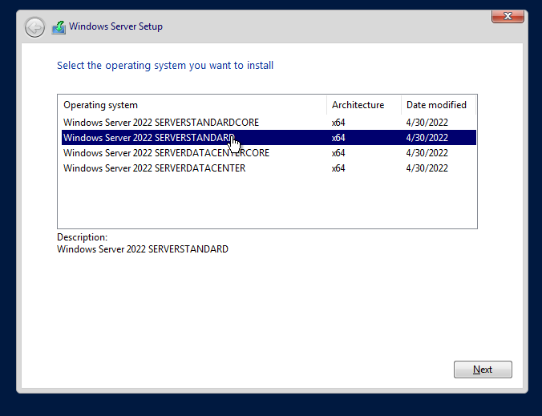

Sistemaren lizentzia eskatuko dizu; ez daukazula aukeratu beharko duzu. Gero, baldintzak onartu beharko dituzu.

Orri honetan, instalatzeko aukera hautatu beharko duzu, ez dugulako lehendik instalatutako sistemarik.

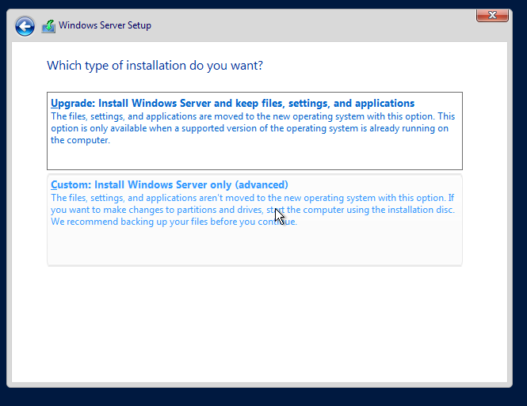

Orain, sistema zein gailutan instalatu nahi duzun aukeratu beharko duzu. Honekin soilik EFI partizioa sortuko da diska horretan, gure sistema eragilea hau erabilita abiarazteko.

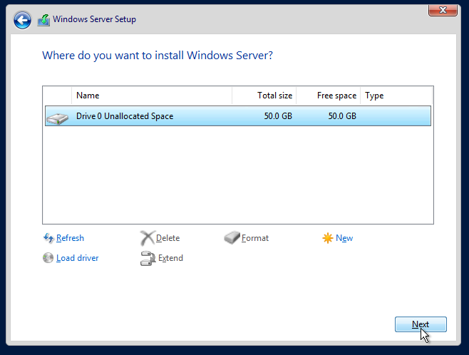

Eta pantaila honetan, instalazioa amaitu arte itxaron besterik ez duzu egin behar.

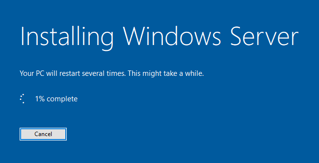

# 3. Oinarrizko konfigurazioak

Gure zerbitzariak ondo funtzionatzeko oinarrizko konfigurazio batzuk behar ditu.

## IP

Lehenik, IP finko bat ezarriko dugu. Ireki "Configuración" > "Red e internet" > "Ethernet" > "Asignación IP" > "Manual", eta jarri nahi duzun IP-a. Ez badakizu zein den Gateway-aren IP-a, ireki cmd eta idatzi hau:

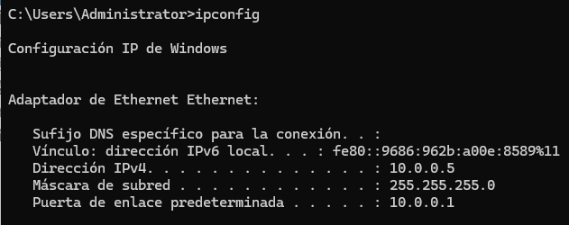 Red e internet > Ethernet >…" width="600" style="max-width:100%;">

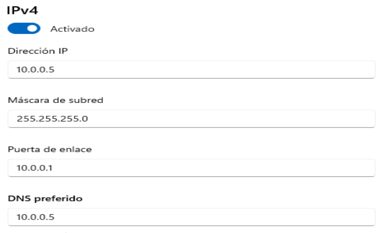 Red e internet > Ethernet >…" width="384" style="max-width:100%;">

## Erabiltzaileak eta taldeak sortzea

Pertsona bat baino gehiagoko lan-eremu batean, denek erabiltzaile bera izatea kaosa izango litzateke. Horregatik, bakoitzari bere erabiltzailea sortuko diogu.

Hau egiteko, sakatu `Win+X` eta ireki "Administración de equipos".

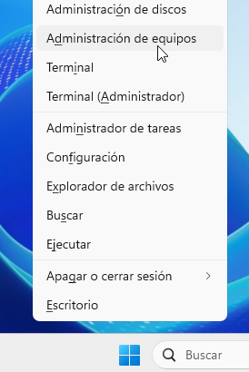

Gero, joan "Usuarios y grupos locales" atalera eta, bertan, "Usuarios" karpetara.

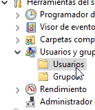

Barruan, eskuineko klika erabilita, "Usuario nuevo" sortuko dugu.

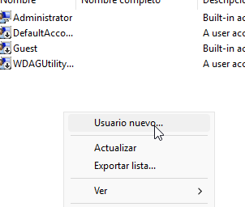

Izen bat emango diozu; gainerakoa aukerakoa da, baina pasahitza jartzea gomendatzen da. Guk horrela egingo dugu.

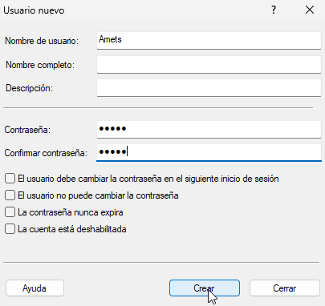

Erabiltzaileak sortu ondoren, taldeak sortu beharko ditugu, bakoitzari talde bidez baimen ezberdinak emateko. Horretarako, leiho berean, joan "Grupos" atalera.

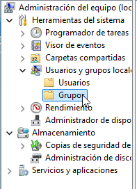&nbsp;&nbsp;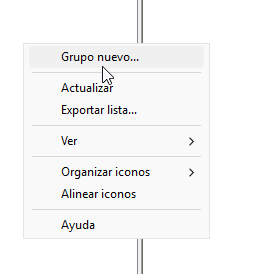

Taldeei izena eman eta bertan aukeratu ahal duzu nor egongo den talde bakoitzean.

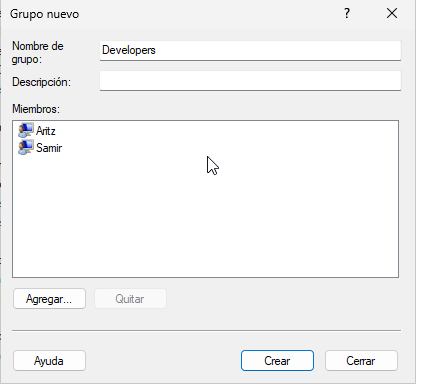&nbsp;&nbsp;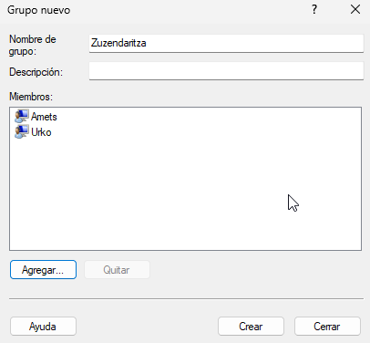

## Erabiltzaileak eta taldeak administratzea

Erabiltzaile hauek sortu ondoren, haien segurtasuna bermatzea izango da gure zeregina.

Lehenik, pasahitz-arauak aplikatuko ditugu, beste inork gure erabiltzailea erabili ezin dezan.

Ireki "Directiva de seguridad local".

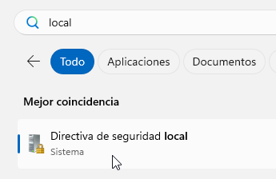

Bilatu "Directivas de cuenta" > "Directivas de contraseñas"; hemen dituzu pasahitzentzako ezarpen guztiak. Kasu honetan, konplexutasun minimoa eta luzera minimoa aldatuko ditugu, erabiltzaileak ez beste inork pasahitza jakin ez dezan.

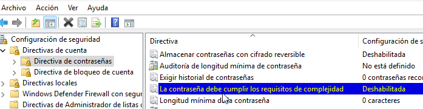 Directivas de contraseñas; hemen dituzu pasahitzentzako…" width="600" style="max-width:100%;">

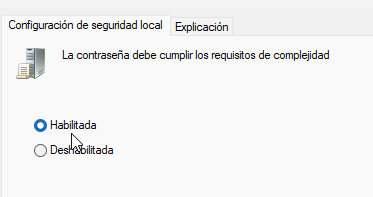 Directivas de contraseñas; hemen dituzu pasahitzentzako…" height="132" style="max-width:100%;">&nbsp;&nbsp;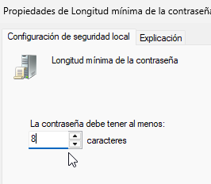 Directivas de contraseñas; hemen dituzu pasahitzentzako…" height="132" style="max-width:100%;">

"Directivas de bloqueo de cuenta" atalean, pasahitz-hutsegite kopuru maximo bat ezarriko dugu; erabiltzailea ez den norbaitek behin eta berriz huts egiten badu, segurtasunagatik kontua blokeatu egingo da.

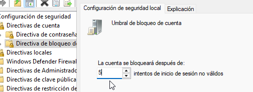

Sistema eragile bat seguru izateko beste atal garrantzitsu bat erabiltzaileei baimen egokiak ematea da. Adibidez, praktikaldiko ikasle bat badugu, bere erabiltzailea izango du, baina ez du baimenik izango aldaketa garrantzitsurik egiteko, hala nola web-orriaren edukia aldatzeko.

Horretarako, bilatu baimen hauek ezarri nahi dituzun unitatea edo karpeta. Gure kasuan, `inetpub` karpetaren baimenak kudeatuko ditugu, bertan baitaude web-orrien datu guztiak.

Karpeta kokatu ondoren, egin eskuineko klik eta ireki "Propiedades".

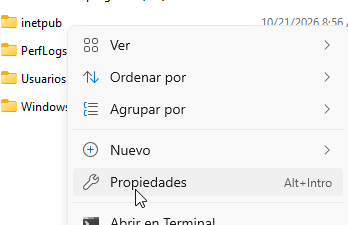

Joan "Seguridad" atalera eta sakatu "Editar" baimenak kudeatzeko tresnara sartzeko.

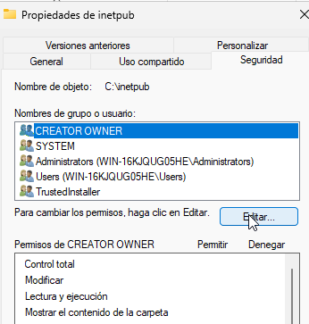

Nahi duzun erabiltzailea aurkitzen ez baduzu, bere baimenak "Users" taldean lehenetsita daudelako da. Ikaslearen baimenak espezifikoki kudeatzeko, "Agregar" botoiarekin gehitu beharko dugu.

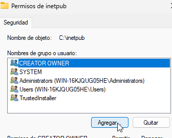

Erabiltzailearen izena idaztearekin nahikoa da; "Comprobar nombres" erabilita, bere ibilbidea automatikoki idatziko du.

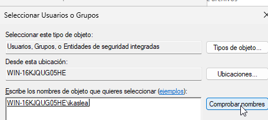

Hau eginda, zerrendan agertu beharko litzateke, eta beheko atalean bere baimenak. Aldatu zure beharren arabera.

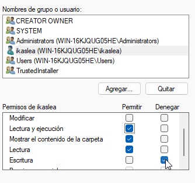

Orain, ikasle gisa, ez duzu baimenik izango `inetpub` karpetan aldaketarik egiteko.

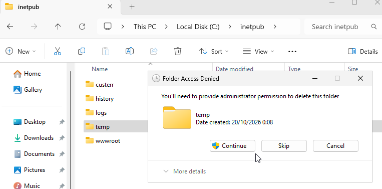

## Kuotak ezartzea

Sistema batean erabiltzaile bat baino gehiago daudenean, garrantzitsua da bakoitzari bere biltegiratze-zatia ematea, batak besteari ez kentzeko. Horretarako dira disko-kuotak.

Hau ezartzeko, fitxategi-arakatzailean ("Explorador de archivos") joan zure diskora.

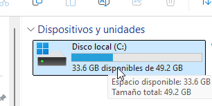

Ireki "Propiedades" > "Cuota…".

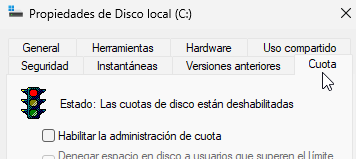 Cuota…" width="277" style="max-width:100%;">

Gaitu kuota-administrazioa eta kudeatu mugak zure gustura.

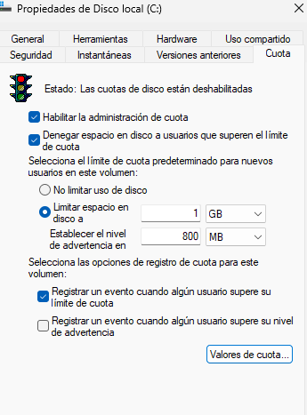

## RAID

Zerbitzari batek bere datuak hutsegiteetatik ere babestu behar ditu; horretarako dago RAID teknologia. Gure kasuan, RAID-5 eta ispilatua (RAID-1) erabiliko ditugu. RAID-5ekin, disko bat galtzen denean, beste biren datuekin hirugarrenarena birkalkulatu eta berreskuratu daiteke, daturik galdu gabe.

Ispilatuan, bi disko erabiltzen dira, biak datu berberekin. Batek huts egiten badu, besteak berreskuratu ahal izango ditu datuak.

Hasteko, diskak gehitu behar ditugu gure makinara. VirtualBox-en egiteko, honela egin behar da.

"Medio" dagoen lekura joan eta aukeratu disko berria sortzea.

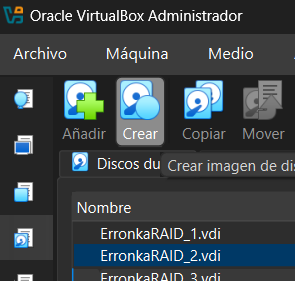

Orain, honen izena eta edukiera aukeratzeko aukera emango dizu. Horrelako 3 sortu gutxienez.

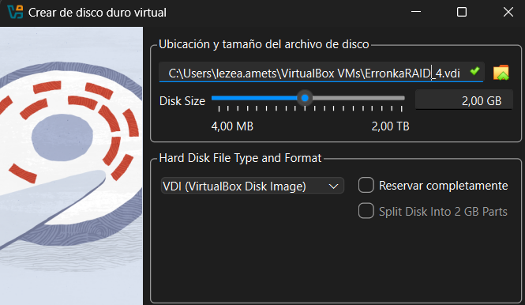

Orain makinan sartuko ditugu.

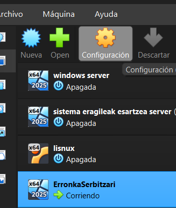

Sakatu "Almacenamiento" > "Añadir disco".

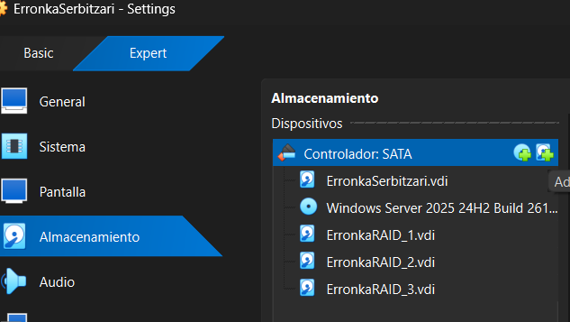 Añadir disco" width="600" style="max-width:100%;">

Gehitu lehen sortutako diskak.

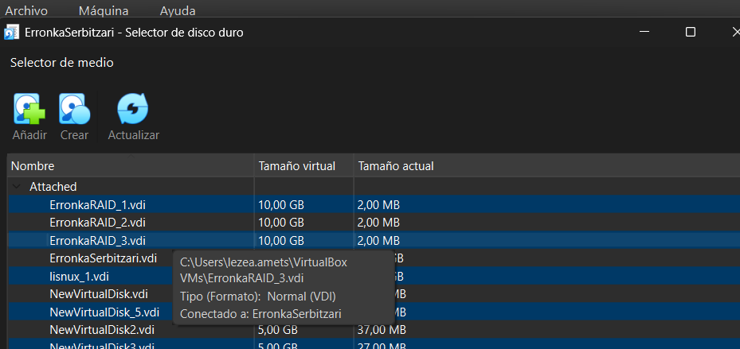

**GOGORATU!!** Diskek funtzionatzeko, kontrolagailu birtualean SATA gehiago jarri behar dituzu.

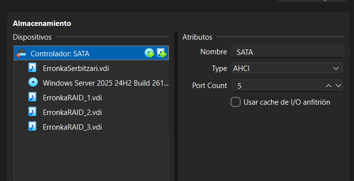

Hau eginda, makina berriro abiarazi dezakegu. Sakatu `Win+X` eta ireki "Administración de discos".

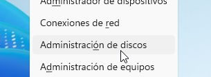

Aurkitu orain gehitutako diskak eta aukeratu nahi duzun formatua. Orain RAID-1 azalduko dut.

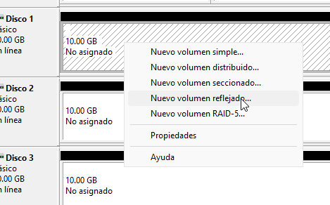

Behin "Nuevo volumen" sakatuta, zein disko erabili galdetuko dizu.

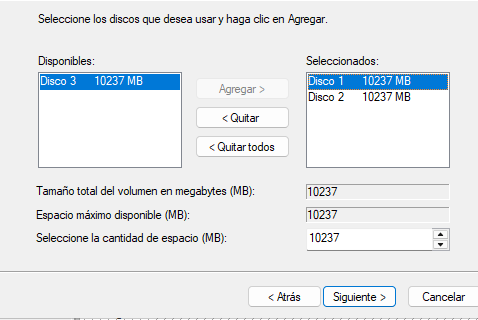

Gero, letra bat esleitzeko eskatuko dizu.

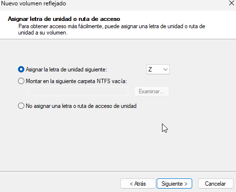

Gero, zein sistema mota erabili eta izen bat galdetuko dizu.

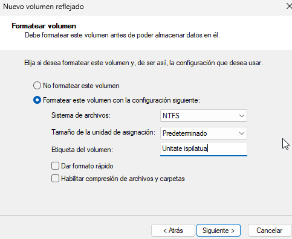

Hau guztia jarraian eginda, bukatuta egon beharko litzateke. Menuak itxura hau izan beharko luke:

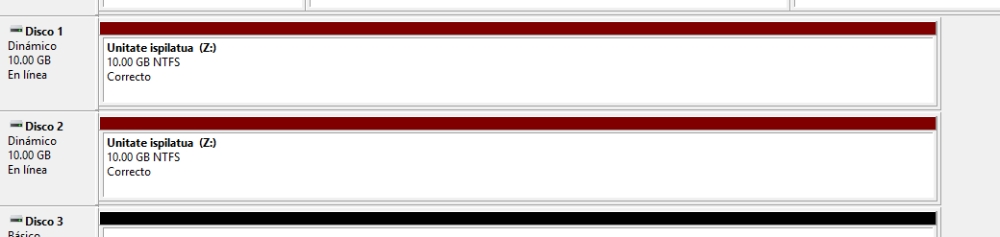

RAID-5erako prozesua nahiko berdina da; funtzioa baino ez da aldatzen.

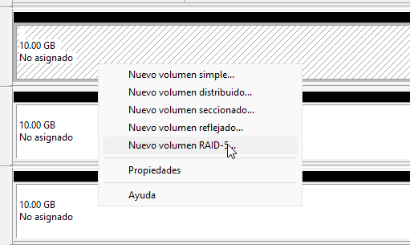&nbsp;&nbsp;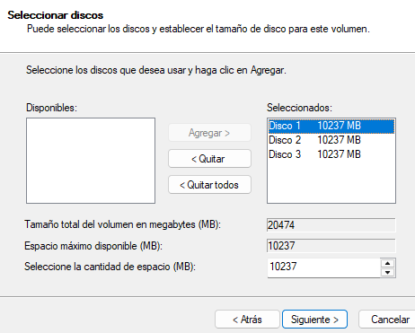&nbsp;&nbsp;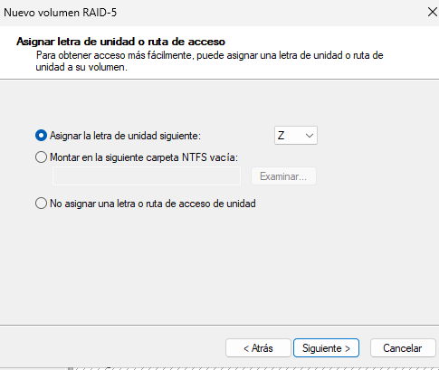&nbsp;&nbsp;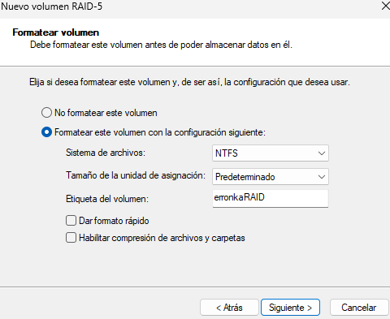&nbsp;&nbsp;

## Babeskopia

Zerbitzaria guztiz babestuta dagoela bermatzeko, babeskopia-zerbitzu bat izatea garrantzitsua da. Horretarako, zerbitzu hau instalatzearekin hasiko gara.

Zerbitzari-administratzailean, klikatu "Administrar" > "Agregar roles y características".

 Agregar roles y características" width="574" style="max-width:100%;">

Joan "Características" atalera arte eta aukeratu "Windows Server Backup". Jarraitu eta instalatu.

Instalatu ondoren, ireki segurtasun-kopien tresna.

Klikatu "Copia de seguridad local" eta, kopiak aldizka egin nahi badituzu, "Programar copia de seguridad".

Jarraitu eta aukeratu nahiago duzun aukera.

Orain, aldizkako kopiaren ordutegiak ezarri beharko dituzu.

Orain, kopia non gorde galdetuko dizu. Aukerarik onena sistematik aparte dagoen disko batean gordetzea da.

Nire kasuan, beste disko batean gordetzea erabaki dut. Gogoratu kasu honetan diskoak sistema dagoen diskoaren tamaina bera edo handiagoa izan behar duela.

Azkenik, kopiaren xehetasunak erakutsiko dizkizu, dena ondo dagoen ikusteko.

Eta horrekin amaituta egongo da.

# 4. Zerbitzuak

## Instalazioak

Zerbitzari baten funtzio nagusia zerbitzuak eskaintzea da.

Lehen urratsa zerbitzuak instalatzea da. Ireki sisteman lehenetsita datorren zerbitzari-administratzailea eta jarraitu honela: "Administrar" > "Agregar roles y características".

Jarraitu "Roles" atalera arte eta aukeratu behar dituzunak. DHCP, DNS eta IIS dira ohikoenak. "Características" atalean, "Windows Server Backup" ere ondo dator gerorako.

Hau egin ondoren, jarraitu botoia sakatuz honaino iritsi arte. Dena ondo egon beharko litzateke.

## DNS

Dena instalatuta dugunean, DNS-rekin hasiko gara. Zerbitzu honek izen bat IP batekin lotzen du, eta alderantziz. Horrela, erabiltzaileek errazago aurkituko dute domeinu bat edo sare bat.

Horretarako, zerbitzari-administratzailean, "Herramientas" > "DNS".

 DNS" width="419" style="max-width:100%;">

Barruan sartuta, klikatu zerbitzarian eta DNS konfiguratzen hasi gaitezke.

Zein funtzio konfiguratu nahi duzun galdetuko dizu. Bai bilaketa zuzena bai alderantzizkoa gomendatuko nuke, biak beharrezkoak izango direlako.

Sortu zona nagusia.

Zure zonari izena emateko eskatuko dizu.

Hurrengo urratsak berdinak dira, edo automatikoki jarraitu ditzakezu.

&nbsp;&nbsp;&nbsp;&nbsp;

Alderantzizko zonarako, zure sarearen IDa beharko duzu (IP-aren hasiera).

Jarraitu honela:

Hau ez da baliagarria Interneterik gabeko lan batean.

Hau egin ondoren, errore bat agertu daiteke. Lasai, konfigurazioa eskuz jarrai dezakegu.

Lehenik, host bat sortu behar dugu. Ireki "Zonas de búsqueda" eta "Host nuevo".

Eman nahi duzun izena eta lotu zure zerbitzariaren IP-ra.

Orain, hauek konfiguratuko ditugu:

Lehenengo orrian, hauek gure host-arekin lotu behar ditugu.

Gero, "Servidores de nombres" atalean, zure zerbitzariaren IP-a jarri beharko duzu. Zure zerbitzariaren izena agertzen bada, "Resolver" sakatzearekin nahikoa da.

Bi urrats hauek alderantzizko zonarekin ere egin beharko dituzu.

Hau guztia eginda, ireki cmd eta erabili komando hau zerbitzariaren IP-arekin. Dena ondo egin baduzu, horrelako zerbait agertu beharko litzateke.

## IIS

Bezeroek gure zerbitzuetara iristea nahi badugu, web bidezko sarbidea izatea da onena. Horretarako dago IIS zerbitzua.

Hau konfiguratzen hasteko, zerbitzari-administratzailean bilatu interneteko zerbitzuen administratzaile-tresna (IIS).

Bilatu "Sitios" atala eta ireki zerbitzariaren adarra.

Zure web-orria zerbitzu honetan ezartzeko, zerbitzuaren karpetara joan beharko zara eta bertan itsatsi zure kode eta eduki guztia.

Horretarako, "Default Web Site" gainean eskuineko klik eginda, aukeratu "Explorar".

Honek `wwwroot` karpetara eramango zaitu. Bertan, zerbitzuak aurrez instalatutako web-orri txiki bat dago; hori ezabatu eta horren ordez zurea jarri dezakezu.

Hurrengoa, gure orria DNS-ra lotzea da.

Gure web-orrian klik eginda, eskuineko barran sakatu "Enlaces".

Eta gehitu zure zerbitzariaren IP-a. Garrantzitsua da "Host" atalean zure DNS zerbitzuko host-aren helbidea jartzea.

Hau eginda, egiaztapen-protokoloa jarraitu.

Lehenik, zerbitzariaren IP-a nabigatzailean jarrita:

DNS helbidea erabiliz:

Beste gailu batetik IP bidez:

Eta beste gailu batetik DNS bidez:

